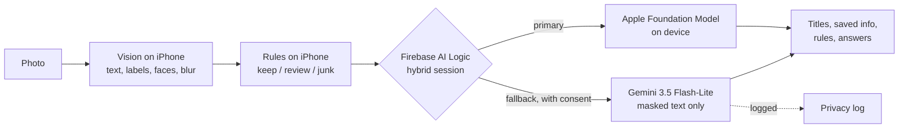

<p align="center">
  <picture>
    <source media="(prefers-color-scheme: dark)" srcset="docs/brand/spectra-logo-on-dark.svg">
    
  </picture>
</p>

<h3 align="center">See your photos in a new light.</h3>

<p align="center">Free up your iPhone in minutes. Keep every memory. Not one photo leaves your phone.</p>

---

**Apple Photos can find your duplicates. It can't tell you what's safe to delete.** Spectra is your iPhone's storage assistant: it decides what can go and tells you why, using **on-device AI**. It splits real photos from clutter, explains every pick, clears expired screenshots, locks ID photos, answers questions about your photos and builds albums from a sentence. The cloud (Gemini) is a fallback that only ever receives **masked text**, and every request it gets is shown in a privacy log.

Built for **#BuildHybridAI 2026** with **Firebase AI Logic hybrid inference**.

## What it does

| | |
|---|---|
| **Sorts the whole roll** | Real photos, duplicates, blurry shots, forwards, expired OTP and payment screenshots, receipts, IDs and cards, big videos, AI-made images. Every pick has a plain reason. |
| **Frees space safely** | "Get me space": pick 1 GB, review the least risky items first, slide to confirm. Real photos, favourites and IDs are never pre-selected. Big videos can be re-saved in HD instead of deleted. |
| **Ask your photos** | "What's my Wi-Fi password?" Spectra finds the screenshot and answers on the iPhone, showing the photo it came from. |
| **Search by meaning** | "dog at the beach", "receipts from swiggy", "goa trip". Words, what's in the picture, and dates. |
| **Smart albums from a sentence** | "Bills and receipts go to Tax 2026" becomes a real Photos album that keeps itself up to date. Suggested albums appear on their own. |
| **Locks IDs** | Aadhaar, PAN, cards and passports are detected with checksums and moved to the Hidden album. Their text never reaches any model. |
| **A full gallery** | Grid with pinch zoom, viewer with Live Text, filmstrip, share, duplicate, hide, slideshow, adjust date and location, add to album, tickets to Calendar. |
| **Everywhere on iOS** | Home-screen widget, Siri and Shortcuts ("Ask Spectra…"), weekly digest, light and dark mode, VoiceOver and Dynamic Type. |

## How the hybrid AI works



- **AI explains, it never deletes.** Deterministic, checksum-based rules make every keep / review / junk call, so the result is predictable and fast (500 photos in about 63 s on an iPhone 17). The model writes titles, pulls out saved info (bookings, addresses), turns sentences into album rules and answers questions.
- **On-device first.** Every structured call goes through `FirebaseAI.generativeModelSession(model: .hybridModel(primary: .systemModel(), secondary: .geminiModel(...)))` with guided generation (`@Generable`), so the output always fits the app's types.
- **Cloud only with consent, only masked text.** Numbers, emails, phone numbers and UPI IDs are masked before anything leaves the phone. ID photos and the text read from photos for Ask never go to the cloud. Each request appears in the privacy log with the exact text sent.
- **Visible.** Every AI answer carries a badge: *On this iPhone* or *Gemini · masked text*. The Privacy log has a demo switch that simulates an iPhone without Apple Intelligence, so the fallback can be seen working.
- **App Check** protects every Firebase AI Logic call.

Picture search uses an on-device image-text model (OpenAI CLIP ViT-B/32, MIT, run with Core ML) to index what photos look like. Vision and CLIP only turn pixels into searchable data on the phone. Every generative step goes through Firebase AI Logic.

## Run it

Requirements: Xcode 27, an iPhone with iOS 26 (Apple Intelligence on for on-device AI), [XcodeGen](https://github.com/yonaskolb/XcodeGen).

1. **Firebase:** create a project, add an iOS app with bundle ID `com.mohitgoyal.tidyroll`, enable **Firebase AI Logic** (Gemini Developer API) and **App Check**. Put `GoogleService-Info.plist` in `App/` (it is git-ignored).
2. **Picture search models (optional, about 150 MB):**
   ```sh
   uv venv --python 3.12 .clipenv
   VIRTUAL_ENV=.clipenv uv pip install torch==2.5.1 transformers==4.46.3 coremltools==8.1 numpy==1.26.4 pillow
   .clipenv/bin/python scripts/convert_clip.py App/Resources/Models
   ```
   Without them the app builds and picture search is off.
3. **Build:** `xcodegen generate`, open `TidyRoll.xcodeproj`, set your team, run on the iPhone.
4. **App Check debug token (Debug builds):** on first run the console prints a debug token. Add it in Firebase console → App Check → Apps → Manage debug tokens.

The debug provider is compiled into Debug builds only. Release builds use Apple App Attest only: add the App Attest capability (needs a paid Apple Developer account) and register App Attest in Firebase console → App Check.

## Tests

| Suite | What | Command |
|---|---|---|
| Core | 107 tests: rules, checksums, masking, matching, retrieval, suggestions | `cd Packages/TidyCore && swift test` |
| App | 39 tests on device, including the real on-device model and a real Gemini call | `xcodebuild -scheme TidyRoll -destination 'id=<iPhone>' test` |
| UI | 18 flows driven on a real iPhone with test photos only, cleaned up after | `xcodebuild -scheme TidyRollUI -destination 'id=<iPhone>' -allowProvisioningUpdates test` |

## Project map

| Path | |
|---|---|
| `Packages/TidyCore` | Pure Swift logic: rules, checksums, masking, similarity, matching, retrieval |
| `App/AI` | Firebase AI Logic: hybrid judge, rule compiler, Ask, calendar events |
| `App/Index` | Scanner, index store, background enrichment, smart album rules |
| `App/Clip` | On-device picture search |
| `App/UI` | SwiftUI screens (iOS 26, Liquid Glass) |
| `Widget`, `App/Intents` | Home-screen widget, Siri and Shortcuts |
| `docs/brand` | Logo and icon SVGs |

License: Apache-2.0.
